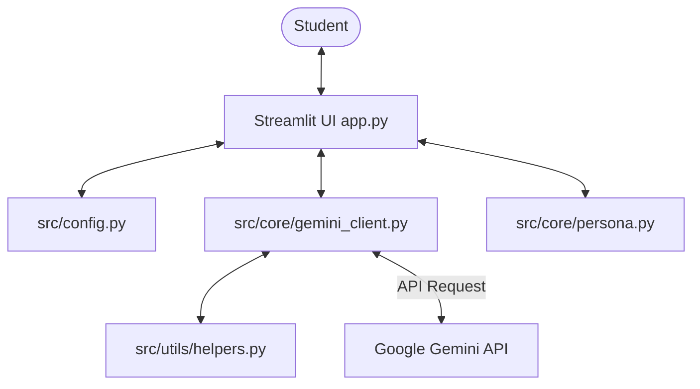

# Komali - My AI Learning Buddy


[](https://www.python.org/)
[](LICENSE)
[](Dockerfile)

An interactive, responsive, AI-powered tutoring application designed to help students master any study topic. Built with Python, Streamlit, and Google Gemini API (`gemini-1.5-flash` or `gemini-2.0-flash`), the application simplifies complex ideas with analogies, tests understanding via interactive quizzes, and allows students to ask follow-up questions in real-time.

---

## 🌟 Key Features

*   **💡 Concept Explainer:** Breakdown of any complex academic topic into simple, structured explanations with key highlights and summaries.
*   **🍎 Real-Life Analogies:** Connects abstract theory to familiar real-world scenarios.
*   **📝 Interactive Quiz Engine:** 
    *   Generates dynamic 5-question multiple-choice quizzes (MCQs) via Gemini.
    *   Offline mode: Load a pre-set sample quiz on **SQL Joins** immediately (works without an API key!).
    *   Persisted scores, color-coded answers, and detailed grading feedback for each question.
*   **💬 Stateful Tutor Q&A:** Chatbot assistant that maintains state history for follow-up conversations on the current topic.
*   **🎓 Student Corner:** Built-in viewer exhibiting all assignment deliverables required for grading (AI Persona, prompt templates, conversation transcript, quiz questions, and AI limitations reflection).

---

## 🏗️ Architecture & Tech Stack



*   **UI/UX:** Streamlit (injected with custom glassmorphism styling and responsive viewport parameters).
*   **AI Engine:** Google Gemini SDK (`google-generativeai`).
*   **DevOps:** Docker, Docker Compose.
*   **Local Tunneling:** `pyngrok` (for Google Colab deployments).
*   **Testing:** `pytest` + `pytest-mock`.

---

## 🚀 Quick Start Guide

### Prerequisites
1.  Python 3.10+ installed.
2.  A Google Gemini API key. Get one for free from [Google AI Studio](https://aistudio.google.com/app/apikey).

### Installation & Run

1.  **Clone the Repository:**
    ```bash
    git clone https://github.com/your-username/ai-learning-buddy.git
    cd ai-learning-buddy
    ```

2.  **Create and Activate a Virtual Environment:**
    ```bash
    python -m venv venv
    # Windows:
    venv\Scripts\activate
    # macOS/Linux:
    source venv/bin/activate
    ```

3.  **Install Package Dependencies:**
    ```bash
    pip install -r requirements.txt
    ```

4.  **Set Up Credentials:**
    *   Copy the `.env.example` file to `.env`:
        ```bash
        cp .env.example .env
        ```
    *   Open `.env` and fill in your Gemini API key:
        ```env
        GEMINI_API_KEY=your_actual_api_key_here
        ```

5.  **Run the Web App:**
    ```bash
    streamlit run app.py
    ```
    Your default web browser should open automatically to `http://localhost:8501`.

---

## 🐳 Run in Docker

Deploy instantly in a containerized environment using Docker Compose:

1.  Configure the `.env` file in the root folder.
2.  Launch the container:
    ```bash
    docker-compose up --build -d
    ```
3.  Access the app at `http://localhost:8501`.
4.  Stop the app:
    ```bash
    docker-compose down
    ```

---

## 📓 Running in Google Colab (with ngrok)

For developers wanting to test the app on cloud notebooks as specified in the assignment guide:
1.  Locate the notebook: `notebooks/AI_Learning_Buddy_Colab.ipynb`.
2.  Open or upload it to [Google Colab](https://colab.research.google.com/).
3.  Fill in your Gemini API Key and ngrok Auth Token in the designated cells, and run the notebook cells in order.
4.  Click the printed `ngrok-free.app` URL to access your app.

---

## 🧪 Testing Suite
Run automated unit tests to verify prompt integrity and config validation:
```bash
pytest tests/
```

---

## 📂 Detailed Documentation

*   [System Architecture & Design (docs/PROJECT_DOCUMENTATION.md)](file:///c:/Users/komal/Documents/MY%20CODES/@Projects/ai%20study%20buddy/docs/PROJECT_DOCUMENTATION.md)
*   [Feature Specifications & Operation (docs/FEATURES.md)](file:///c:/Users/komal/Documents/MY%20CODES/@Projects/ai%20study%20buddy/docs/FEATURES.md)
*   [Deployment Guidelines (docs/DEPLOYMENT.md)](file:///c:/Users/komal/Documents/MY%20CODES/@Projects/ai%20study%20buddy/docs/DEPLOYMENT.md)
*   [API Details & Prompt Engineering (docs/API.md)](file:///c:/Users/komal/Documents/MY%20CODES/@Projects/ai%20study%20buddy/docs/API.md)

---

## 🛠️ Troubleshooting

*   **Problem: "Address already in use" on launch**
    *   *Solution:* Streamlit is already running on port 8501. Terminate the other process or run on a custom port: `streamlit run app.py --server.port 8502`.
*   **Problem: "Authentication failed / Invalid API key"**
    *   *Solution:* Ensure your Gemini API Key is pasted correctly in `.env` or in the sidebar. Check that there are no leading/trailing spaces or quotation marks inside the `.env` value.
*   **Problem: ngrok tunnel fails to open**
    *   *Solution:* Make sure you signed up for a free account at `ngrok.com` and generated your Authtoken. Paste it into the sidebar or your `.env` file under `NGROK_AUTH_TOKEN`.
