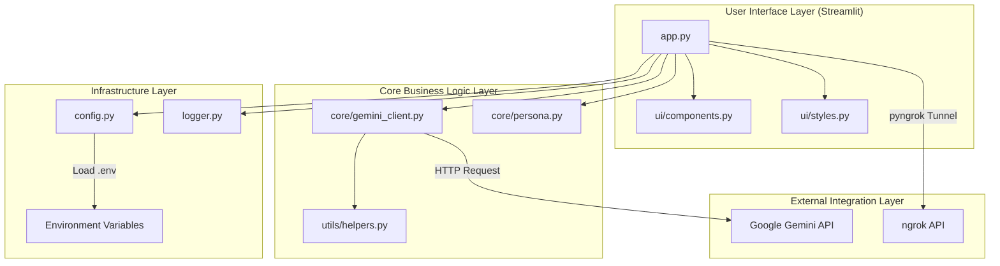

# Project Documentation: AI Learning Buddy

Welcome to the technical design and architectural documentation of the **AI Learning Buddy**.

---

## 1. System Overview
The **AI Learning Buddy** is a responsive web application designed to act as an automated, interactive tutor for students. Powered by the Google Gemini API (leveraging `gemini-1.5-flash` or `gemini-2.0-flash`), the application takes a student's chosen topic and facilitates concept explanations, provides real-life examples, generates 5-question quizzes, evaluates answers, and supports open-ended follow-up Q&A.

---

## 2. System Architecture

The following Mermaid diagram outlines the high-level request-response lifecycle and component dependencies:



---

## 3. Directory Layout & Module Responsibilities

```
ai-learning-buddy/
├── .env.example              # Template configuration for environment variables
├── .gitignore                # Specifies intentionally untracked files to ignore
├── Dockerfile                # Instructions to containerize the Streamlit app
├── docker-compose.yml        # Multi-container Orchestration configuration
├── LICENSE                   # Open-source MIT License terms
├── CONTRIBUTING.md           # Developer guidelines for submitting issues and code
├── requirements.txt          # Python dependency checklist
├── README.md                 # Project quick-start manual
├── app.py                    # Main Streamlit executable (orchestrates state and tabs)
├── docs/                     # Full Technical Manuals
│   ├── PROJECT_DOCUMENTATION.md # Architecture, principles, and module roles
│   ├── FEATURES.md           # Detailed breakdown of core functionalities
│   ├── DEPLOYMENT.md         # Manual, Docker, and Colab deployment guide
│   └── API.md                # Prompt structure and external integrations
├── src/                      # Source Code Namespace
│   ├── __init__.py
│   ├── config.py             # Environment configurations and validation logic
│   ├── logger.py             # Logging setup for standardized console outputs
│   ├── core/                 # Central Business Logic
│   │   ├── __init__.py
│   │   ├── gemini_client.py  # Wrapper for Google Generative AI with error handling
│   │   └── persona.py        # System instructions and prompt templates
│   ├── ui/                   # Frontend Customizations
│   │   ├── __init__.py
│   │   ├── components.py     # Reusable HTML layout blocks and panels
│   │   └── styles.py         # Custom CSS injecting Glassmorphic styles
│   └── utils/                # Helper Libraries
│       ├── __init__.py
│       └── helpers.py        # LLM JSON parsing and schema validators
├── tests/                    # Testing Suite
│   ├── __init__.py
│   ├── test_config.py
│   ├── test_gemini_client.py
│   └── test_persona.py
├── notebooks/                # Google Colab Integration
│   └── AI_Learning_Buddy_Colab.ipynb
├── data/                     # Offline and Sample Asset store
│   ├── sample_conversation.md # Pre-packaged chatbot conversation transcript
│   ├── sample_quiz.json      # Offline-ready quiz mock questions
│   └── reflection.md         # Essay reflecting on AI teaching limitations
└── scripts/                  # Management Tools
    └── package_project.py    # Python script to ZIP the repo for GitHub submission
```

---

## 4. Software Design Principles (SOLID)
We adhere strictly to software design best practices to ensure modularity and ease of maintenance:
1. **Single Responsibility Principle (SRP):**
   - `gemini_client.py` has one reason to change: adapting how we call the Gemini API.
   - `persona.py` handles prompt formatting and persona definitions exclusively.
   - `helpers.py` deals strictly with parsing, cleaning, and validation of schemas.
2. **Open/Closed Principle (OCP):**
   - The `PromptTemplates` class is open for extension (adding new templates) but closed for modification. New features can be appended as new methods without altering existing calls.
3. **Dependency Inversion Principle (DIP):**
   - High-level Streamlit components depend on the client abstraction (`GeminiClient`) rather than calling external libraries directly.

---

## 5. Security & Robustness

### Error Propagation & Handling
We handle common failure points gracefully:
* **Missing Keys:** If `GEMINI_API_KEY` is absent, the app remains functional. It disables the AI-generation buttons, displays warning banners, and prompts the student to securely enter their API key in the browser.
* **API Exceptions:** Network drops, rate limits, or bad key errors from Gemini are intercepted by `GeminiClient` and converted into descriptive user-facing warnings in the Streamlit UI, preventing the app from crashing.
* **JSON Recovery:** Raw LLM outputs are frequently wrapped in markdown code tags. The parsing utility (`extract_json_from_text`) uses regex filters to extract the exact bracket contents and cleanly parse it.
